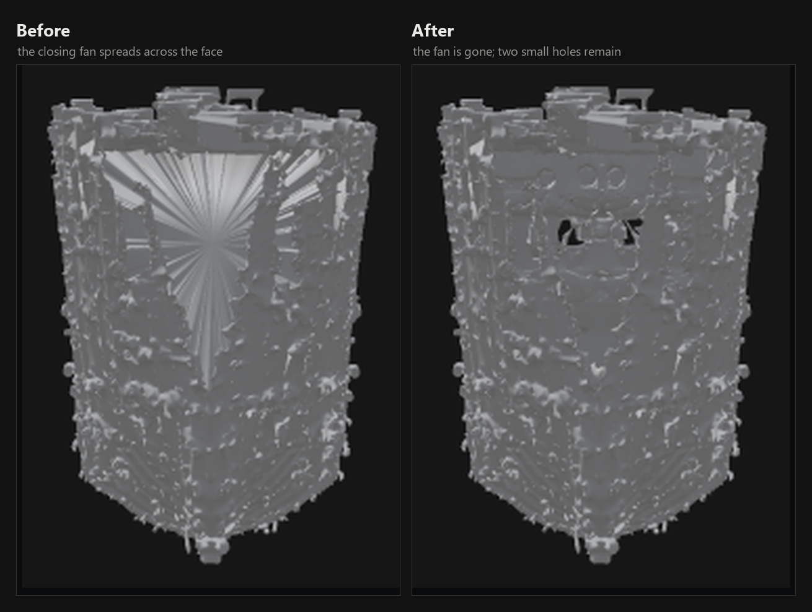

# Changelog

The engine is versioned on its own. LocalMesh, the application built on it,
has its own numbering and its own release notes; the two move at different
speeds and there is no correspondence to read into them.

Entries say what changed in the output or in the failure, and what it cost.
Refactors are not entries.

## v1.2.0 — 11 October 2026

### The photographs' own pixels on the texture

The texture the model returns is drawn: close to the photograph in colour and
shape, wrong in the detail. Printed text comes back as glyphs that read as
nothing. After texturing, every texel that a photograph sees squarely now
takes that photograph's pixel, so a label, a logo or a printed pattern comes
back as it is on the photograph instead of redrawn. Where no photograph sees
the surface (underneath, inside, the back of a single photograph) the drawn
texture stays.

How a texel is assigned:

- The cameras are recovered from the images. With four photographs the
  azimuths are the ones Depth Anything 3 measured for the shape, never measured
  twice; without that measurement, the nominal quarter turns, profiles
  exchanged when the laterality check says so. With one photograph the azimuth
  is searched against the silhouette instead of assumed frontal, because the
  photograph may have been taken from three quarters (silhouette agreement
  against the frontal pose: a bench 0.58 → 0.90, a knife 0.42 → 0.79, a statue
  0.79 → 0.88). The search covers the full turn, because a generated object
  sometimes comes out turned a quarter: against a search limited to ±60°, a
  phone goes from 0.77 to 0.88, and the seven other single photograph
  subjects, those three included, keep exactly their angle. One elevation is
  fitted and shared by all views. Camera roll is searched up to 20° with one
  photograph, 3° with four. Which way the object faces is checked before
  anything is painted, and it is never mirrored.
- A texel is visible from a photograph when a render of the UV coordinates
  from that camera returns the texel itself at its pixel, within 1.5 texels,
  so no depth tolerance is involved. Texels within 5 texels of a depth edge,
  and surface seen at more than about 80° (cosine 0.18), are not read. The
  matte is eroded by 3 px first: the cutout is premultiplied on black, and its
  soft edge used to leave a dark fringe around thin parts.
- Each texel takes the one photograph that sees it most squarely. Nothing is
  averaged. At grazing angles the photograph's share falls off (weight to the
  power 0.35) and the drawn texture shows through. With one photograph the
  boundary between photograph and drawing is feathered over 1.5 % of the
  object; with four it is not (blind comparison, 13 subjects).
- The colour of the unseen, drawn surface is pulled towards the photographed
  surface next to it. The photographs themselves are never retouched. Median
  ΔE on held-out photographed patches: motorcycle 17.8 → 15.4, cassette
  13.7 → 12.8, samurai 19.4 → 16.9. A modest gain; what remains is content,
  not colour.
- The UV gutters are refilled from the final colour after projection. Left
  with the drawn colour, they showed as a thin line along every seam in a
  mipmapped viewer: 14 to 20 ΔE, under 2 now.

Share of the surface that takes a photograph pixel, four photographs:
cassette 59 %, samurai 34 %, motorcycle 32 %.

What it costs: 29 to 73 s per job over the seven runs logged on an RTX 4060
Laptop with 8 GB between 24 September and 11 October, 51 to 67 s for the four
of them made from four photographs, most of it spent fitting the cameras. Peak
3.3 GB, below the texture stage, measured on one subject.

How it was judged: twelve subjects reviewed by eye, not blind. Nine clearly
better, two slightly better, one mixed, none worse. No blind comparison of
projected against drawn has been run on the final settings.

What it cannot do: a correct photograph on a wrong shape doubles. On the
motorcycle the reconstructed exhaust is a cone where the photograph shows a
tube, and the real one lands partly on the swing arm. No texture setting fixes
geometry. `--no-projection` on the command line (`--sans-projection`), or
`projection_texture=False` in `GenerateSettings`, keeps the drawn texture
alone.

It runs on the `texture_mesh` path only. The `to_glb` fallback and the Pixal3D
recipe have other UVs and are left as they were, and a result made of several
textured meshes is skipped. A failure of this step never fails the job: the
drawn texture is kept and a note says why.

### The drawn texture is kept, in a second file

When the projection painted something, the job also writes
`model_<seed>.ai.glb` next to `model_<seed>.glb`: the same mesh, orientation,
scale and material, with the texture as the model drew it. Expect about twice
the disk per job. `GenerateResult.glb_ai`, and `"glb_ai"` in `as_dict()`, name
it; they are `None` when the projection was off, failed or covered 0 %. A
cancellation during the last steps removes it rather than leaving it orphaned.

New progress label, part of the API: `projection de la photo`, from 91 % to
95 %. `LUMENGEN_TRACE_PROJECTION=1` writes `avant_projection.glb` for
comparison.

### Floaters removed in one pass

The debris pass looked up the faces of every small component in the full face
list, then waited on the card, one component at a time. All small components
are now measured in one batched query against the main shell. The rule is
unchanged: a component leaves when the median distance of its vertices to the
shell exceeds the threshold. The median is now taken over all of a component's
vertices rather than a random sample of 512, which changes the decision for
0.01 % of the triangles.

| subject | 1.1.0 | 1.2.0 |
|---|---|---|
| doll | 170 s | 13 s |
| statue | 61 s | 20 s |
| street lamp | 15 s | 3 s |

### A heavy subject no longer overflows the card while texturing

No ceiling guarded the texture stage. A leafy planter, far above the 11,700 to
13,000 texture tokens of a doll or a motorcycle, spilled past 8 GB and ran at
233 s per step: 45 minutes. The texture tokens are now counted on the CPU,
before the shape encoder, against the card's token ceiling (2,600 per GB,
20,800 on 8 GB). Above it the mesh is encoded at 512 and textured by the 512
texture model: four times fewer tokens, a slightly less fine texture. Planter:
45 min → 363 s, peak 10.8 → 2.7 GB. Ordinary subjects stay below the ceiling
and do not change. The detail lost on heavy subjects has not been judged. This
guards the single photograph path; the four photograph texture is not covered.

### Four photographs: the texture stays averaged

A single conditioning sequence for four photographs was measured, the four
views' tokens folded into one trajectory instead of four predictions averaged
at every step: +18 to +62 % fine atlas detail on three subjects, texture step
272 s → 117 s. It did not survive a blind comparison. Seven subjects, same
frozen shape, 84 image pairs seen three times: averaged 150, single sequence
83, equal 19. The averaged path won on the body (36 to 0), the head, both
traffic lights and the samurai; the single sequence on the motorcycle
(25 to 9); the cassette was a tie. Atlas detail measures contrast, not
correctness: the single sequence put a dark stain on a red traffic light lens
that is on neither the photograph nor the 1.1.0 output.

The default therefore stays as in 1.1.0, and the drawn texture from four
photographs is produced exactly as before. `LUMENGEN_TEXTURE_4VUES=ensemble`
selects the single sequence, conditioned at 512 per view;
`LUMENGEN_COND_TEXTURE` overrides that resolution.

Known and not fixed: the averaged path weights each view by the position of
the texel's cell, each axis divided by the grid, and no normal is read. On a
flat subject the thin axis spans a fraction of the grid (12.2 % on a
cassette), so the profile views outvote the front on the large face: mid-face,
front 0.248 against right 0.528. It is invisible on cubic subjects and matters
on flat ones, which are the ones that carry text. The projection covers most
of it on photographed faces. `LUMENGEN_MV_TEX_ISO=1` normalises each axis on
the subject instead, validated on CPU only. `LUMENGEN_BANC_MELANGE_TEX` sets
that path's blend temperature, which was never passed and ran at 2.0.

### Licences

`plyfile` (GPL-3.0) is no longer loaded by the engine. The `o_voxel` wheel
imports it at module level for PLY input and output this engine never
performs; `leurre_plyfile.py` registers a stand-in under that name, installed
right after the nvdiffrast one, whose objects raise and say why if anything
calls them. `_vendu_trellis2/trellis2/utils/mesh_utils.py`, the only vendored
file that imported plyfile, and which nothing imported, is deleted.

`utils3d` and the `o_voxel` wheel still declare `plyfile`, so pip installs it,
and a real plyfile installed outside `LOCALMESH_ROOT` takes precedence over
the stand-in and is reported in the log. To keep it out, run
`pip uninstall -y plyfile` after `pip install -e .` (docs/INSTALL.md, step 4).

The nvdiffrast stand-in now carries a module spec, so
`importlib.util.find_spec("nvdiffrast")` from another library answers instead
of raising `ValueError`, and it reads `LOCALMESH_ROOT` before `LUMENGEN_ROOT`,
like `config.py`.

`_vendu_moge/` is new: MoGe, Microsoft Research, MIT, with its DINOv2
subtree, Meta, Apache-2.0, both copied unmodified and listed in NOTICE. It
serves an optional fine registration of each photograph on the mesh by
surface normals (`relief.py`), off by default: in a blind comparison on
fourteen subjects it lost, without 51, with 28, equal 92. It realigned some
details and bent straight edges into an S. Its weights,
`Ruicheng/moge-2-vitl-normal`, are never downloaded by the engine; without
them the registration is skipped. Its two licence files and its PROVENANCE.md
are listed in the package data, so a built wheel carries them.

### Also

`localmesh_engine.__version__` and the package metadata said 1.0.0 throughout
1.1.0. Both now say 1.2.0.

Three documents still said that a four-view run falls back to the older blend
in silence. It has said so in a note since 1.1.0; the README, INSTALL and
RECIPES now agree with the code.

## v1.1.0 — 12 September 2026

### Hole closing no longer leaves blades across the surface

Closing a boundary loop meant filling it with a triangle fan. On a wide loop
that fan became a sheet drawn straight across the object; on a middling one it
left a single triangle crossing it, long and flat, catching the light from
every angle. The fans were rare and they carried a great deal of surface: on
one test object, 0.46% of the triangles held 17.3% of the visible area, and a
single triangle spanned a quarter of the diagonal.

Two changes, because one was not enough.

`FERMETURE_PERIMETRE` drops from 12.0 to 1.0. This is a cliff rather than a
slope — between 2 and 8 no loop has that perimeter at all, and nothing moves;
at 12 the giant loops pass, up to 58% of the object's span, and the fill spans
them.

Lowering the threshold does not clear the middling loops. The second change
judges the triangle instead of the loop: a triangle whose longest edge exceeds
5% of the object diagonal (`LAME_PART`) *and* whose elongation, longest edge
over shortest, exceeds 8 (`LAME_ALLONGEMENT`) is removed after the closing
pass. Both conditions are needed — a large well-proportioned triangle is
legitimate, a small sliver is harmless noise. A mesh coming out of dual
contouring contains none of these, on any of the ten subjects, which is what
makes the rule safe. Set `LUMENGEN_RETRAIT_LAMES=0` to keep the old behaviour.

Ten subjects were replayed from the mesh captured immediately before the
closing pass, so the comparison holds the input fixed:

| | threshold 12 | threshold 1 + removal |
|---|---|---|
| blades, ten subjects | 2,613 | 0 |
| surface invented by closing | +14% to +67% | +1.7% to +11.8% |

What it costs is the holes that stay open, and they were measured rather than
argued about: both versions were rendered from eight angles and the pixels that
were surface and became background were counted. Median 0.000% of the object's
pixels, worst case 0.027%.

A note on method, since it is the reason this went unnoticed for two days. The
threshold was raised to 12 on 9 September against two witnesses: the silhouette
(unchanged before and after) and the open-edge count (953 → 0). Neither can see
a blade. A blade lying along the surface does not move the silhouette by one
pixel, and the open-edge count falls *whenever* you fill — it is the
measurement applauding the act it is supposed to judge.

### The fine multi-view pass sizes its ceiling to the card

The fine pass refused any subject over 24,000 cells, a constant written when
nothing smaller than 8 GB could run the engine at all. It never looked at the
card. On a smaller card it admitted a subject calibrated for a larger one and
failed minutes into the work; on a larger card it refused subjects that would
have fit. The ceiling is now `max(8000, 3000 × GB)`, which yields exactly 24,000
on the 8 GB card the original measurement was made on. Override with
`LUMENGEN_PLAFOND_CELLULES`.

The refusal also used to advise dropping to a lighter tier, which is no advice
at all when you are already on the lightest. It now names the lever that exists:
fewer photographs.

### A four-view run that falls back to the older blend says so

Four photographs do not always go through the four-view path — the weights may
not be on the machine, or the tier may promise a grid the path cannot produce.
The run used to fall back to the older whole-prediction blend in silence, and
the result was simply worse than it should have been with no way to know why.
It now returns a note saying which of the two it was.

### Also

`localmesh_engine/banc/banc3d.py`, a bench that compares the produced shape
against a ground-truth model rather than counting what can be recounted in the
output file. It exists because indirect indicators misled twice in one day: a
flipped-face score of 0.43% on a back panel that was perfectly smooth and
perfectly empty, and a view weighting that scored best offline and worst on the
bench.

## v1.0.0 — 10 September 2026

The engine as first published: one photograph, or four sides of one subject,
into a textured `.glb` on a single 8 GB NVIDIA card, with no generation service
in the loop. See the [README](README.md) for what it adds to TRELLIS.2.
